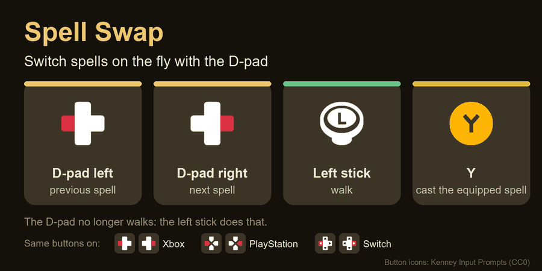

<h1 align="center">Spell Swap</h1>
<p align="center"><b>Switch spells on the fly with the D-pad in Castlevania: Belmont's Curse.</b></p>

<p align="center">
  <a href="https://github.com/PikselYT/belmonts-curse-spellswap/releases/latest"></a>
  <a href="LICENSE"></a>
  
  
</p>

<p align="center"></p>

No more opening the menu in the middle of a fight: press **D-pad ← / →** to go to the previous / next spell
you own. The D-pad no longer walks; the **left stick** does that.

## Which download do I need?

| File | For whom |
|---|---|
| **`SpellSwap-<version>.zip`** | **Most people.** Contains an installer that sets everything up (including the BepInEx mod loader). Start here. |
| `SpellSwap-<version>-plugin-only.zip` | You already have BepInEx 6 (IL2CPP) installed, or use a mod manager. Just the plugin: extract it into the game folder. |

Checksums are in `SHA256SUMS.txt` on the release page.

## Install (30 seconds)

1. **Download** `SpellSwap-<version>.zip` from the [latest release](https://github.com/PikselYT/belmonts-curse-spellswap/releases/latest) and **extract it** anywhere (right-click → *Extract All*).
2. **Close the game**, then double-click **`Install.bat`**.
   It finds your game on its own (Steam), installs the mod loader (BepInEx) if you do not have it, and copies the mod.
   > If Windows shows a blue *"Windows protected your PC"* box, click **More info → Run anyway**. The installer is a plain, readable script (`install.ps1`); it normally does not need administrator rights.
3. **Start the game from Steam.** The **first start is slower (1–3 minutes, the window may look frozen)** while BepInEx prepares itself. Every later start is normal.

That is it. Load a save, press D-pad left/right, and watch the spell icon change.

**Uninstall:** double-click `Uninstall.bat` (it can also remove BepInEx if the installer put it there).
Your save files are never touched.

## Controls and options

| Input | What it does |
|---|---|
| D-pad **left** | previous spell |
| D-pad **right** | next spell |
| Left stick | walk (the D-pad no longer walks) |
| Y | cast the equipped spell, as usual |

It cycles only through spells you own (including ones you pick up later) and only while you are playing, not in menus.
Keyboard controls are unchanged.

Options live in `<game folder>\BepInEx\config\pikselyt.belmontscurse.spellswap.cfg` (created on the first start):

| Option | Default | Meaning |
|---|---|---|
| `Enabled` | `true` | turn the whole mod off without uninstalling |
| `FreeDpadFromMovement` | `true` | take the D-pad away from walking. Set `false` to keep walking with it (then it will also switch spells, so you probably want `Enabled = false` instead) |
| `InvertDirection` | `false` | swap left/right |
| `Verbose` | `true` | write what the mod does to the log (turn off once you are happy) |

## If something goes wrong

* **First start looks frozen / black screen** – wait up to 3 minutes the very first time.
* **D-pad still walks, or nothing happens** – start the game once, quit, and open `<game folder>\BepInEx\LogOutput.log`. You should see lines starting with `Spell Swap`. If not, run `Install.bat` again. If you report an issue, attach that log.
* **Antivirus warning about `winhttp.dll`** – that file is part of BepInEx (a well-known mod loader) and loads mods at startup; some antivirus programs flag this technique by mistake. You can verify the file against the official build (see `THIRD-PARTY-NOTICES.md`).
* **After a game update it stopped working** – mods like this depend on the game's internal code. Check the [releases](https://github.com/PikselYT/belmonts-curse-spellswap/releases) for a new version, or open an issue.
* Anything else: `Uninstall.bat` removes the mod (and, if the installer put it there, BepInEx) and leaves your saves alone.

## Compatibility

* Tested with: Steam version of the game (Unity 2022.3.62f2, `GameAssembly.dll` of 16 Oct 2026), BepInEx 6.0.0-be.789, Windows 10/11, a game controller.
* Single-player. It only changes which spell is equipped, through the game's own function; it never edits save files, so your save stays a normal save.
* Controllers are handled through Unity's generic gamepad, so Xbox/PlayStation/Switch Pro pads should all work; only one type was tested.

## Already use BepInEx? Install by hand

Download `SpellSwap-<version>-plugin-only.zip` and extract it into the game folder (it creates `BepInEx\plugins\SpellSwap\SpellSwap.dll`).
You need **BepInEx 6 (IL2CPP) bleeding-edge build 789 or newer**.

## How it works

A small [BepInEx](https://github.com/BepInEx/BepInEx) plugin. Every second it finds the player's `Inventory` and the game's input actions. It removes the gamepad D-pad binding from the `Player/Move` action (so the D-pad stops walking) and, when the D-pad is pressed, calls the game's own `Inventory.EquipSpellFromInventory` for the next or previous owned spell. The HUD updates itself because the game fires its normal "equip" event.

## Build from source

You need the .NET SDK and a game folder where BepInEx has been started once (it generates the `BepInEx\interop` assemblies the plugin compiles against; they are not redistributed here).

```powershell
powershell -File build.ps1                 # builds and packs dist\SpellSwap-<version>.zip
dotnet build src\SpellSwap -c Release -p:GameDir="D:\Games\Castlevania Belmont's Curse"   # just compile (+ copy into the game)
```

`tools/ApiDump` is a small helper that lists the classes and methods of the generated interop assemblies, handy for writing other mods.

## Credits and disclaimer

Built on [BepInEx](https://github.com/BepInEx/BepInEx). Button icons in the picture above: [Kenney Input Prompts](https://kenney.nl/assets/input-prompts) (CC0). MIT licensed (see [LICENSE](LICENSE), third-party details in [THIRD-PARTY-NOTICES.md](THIRD-PARTY-NOTICES.md)).
This is an unofficial fan project, not affiliated with Konami or the game's developers. It contains no game code or assets.
Check the game's terms before sharing mods; use at your own risk, and keep a copy of your save.
